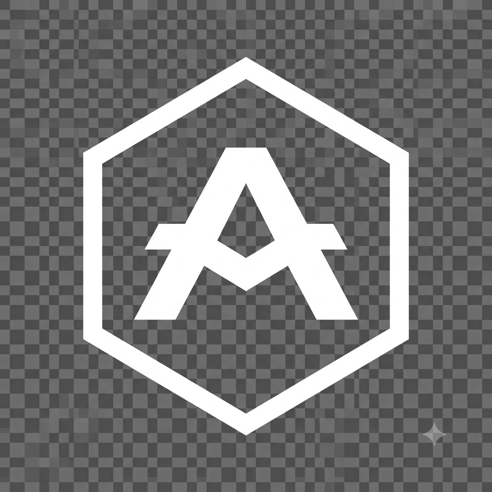
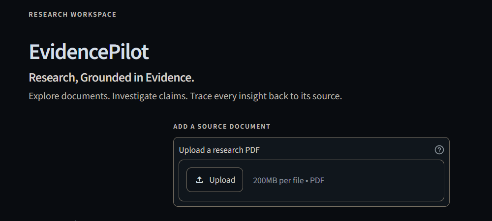
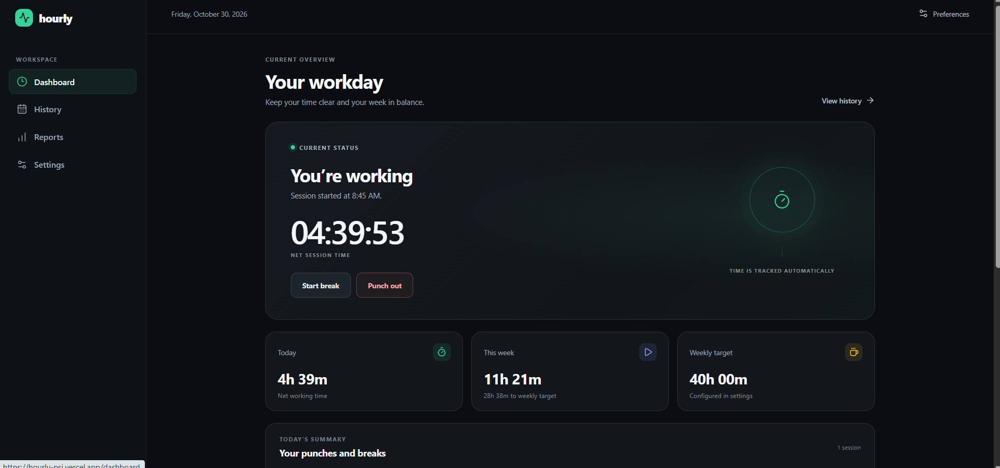
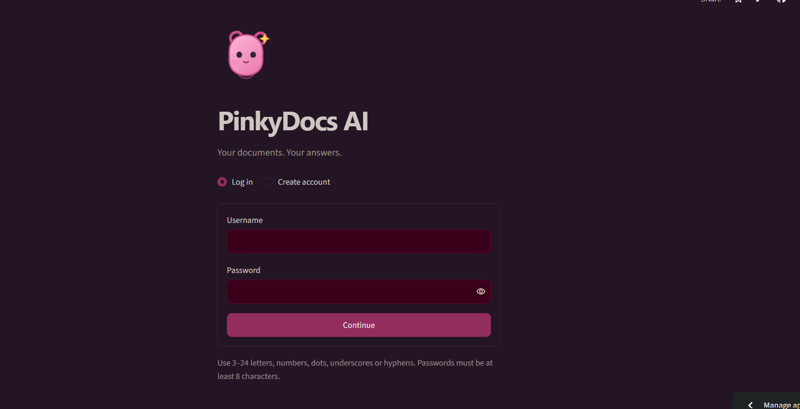
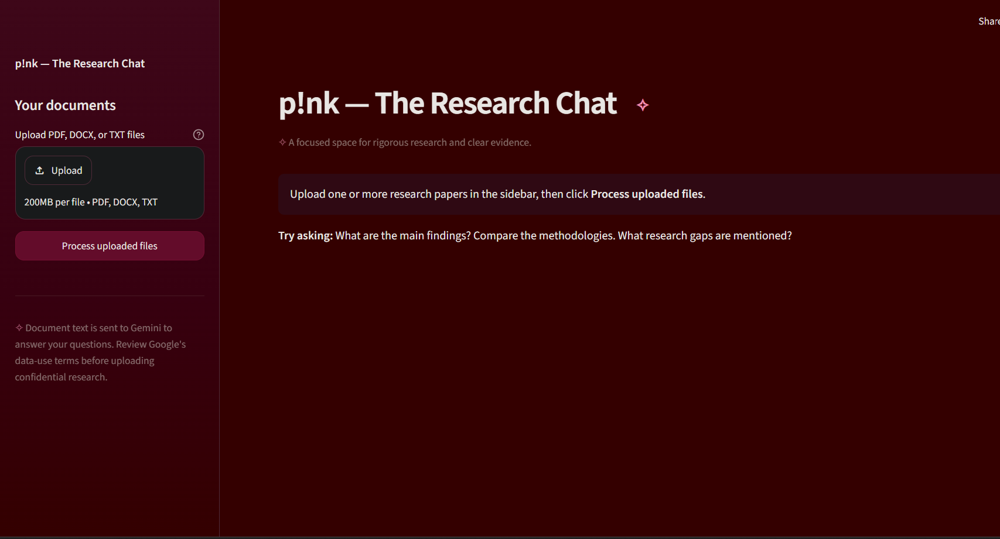

# Aravind S Asok — Developer Portfolio

  

<strong>Backend engineering, full-stack products, and practical AI applications.</strong>

  
  
  
  
  

This repository contains the source for Aravind S Asok's personal developer portfolio. It is a content-driven Gatsby site that presents professional experience, selected projects, technical skills, and contact links through a responsive React interface.

> This is the Gatsby portfolio implementation in this repository. The technology badges describe this codebase, not any newer portfolio rebuild hosted elsewhere.

## Portfolio sections

- **Featured work:** curated projects with summaries, technology tags, screenshots, GitHub links, and live demos.
- **Project archive:** additional engineering work grouped into maintainable Markdown content.
- **Experience:** role and company entries managed independently from page components.
- **Responsive presentation:** Gatsby and React components styled with styled-components.
- **Search and social metadata:** Gatsby plugins generate sitemap, robots metadata, image processing, and Open Graph assets.

## Selected project previews

These images are committed in the static/projects directory and are used by the portfolio content.

| Project | Preview |
| --- | --- |
| EvidencePilot |  |
| Hourly |  |
| PinkyDocs AI |  |
| Research Chat |  |

## Technology

| Area | Technology |
| --- | --- |
| Static site framework | Gatsby 3 |
| UI | React 17 |
| Styling | styled-components |
| Motion and scrolling | Anime.js, ScrollReveal, Lenis |
| Content | Markdown via Gatsby Transformer Remark |
| Images | Gatsby Image, Sharp |
| SEO and metadata | React Helmet, sitemap and robots plugins |
| Code highlighting | Prism.js |
| Package manager | Yarn |

## Content architecture

The site separates portfolio content from presentation components:

~~~mermaid
flowchart TD
  JOBS[content/jobs Markdown] --> GATSBY[Gatsby data layer]
  FEATURED[content/featured Markdown] --> GATSBY
  PROJECTS[content/projects Markdown] --> GATSBY
  CONFIG[src/config.js] --> SITE[React portfolio pages]
  GATSBY --> SITE
  IMAGES[static/projects screenshots] --> GATSBY
  SITE --> BUILD[Gatsby production build]
  BUILD --> WEB[Static portfolio website]
~~~

## Run locally

### Requirements

- Node.js 16.20.2 (see .nvmrc)
- Yarn 1.x

### Install and start

~~~bash
nvm install 16.20.2
nvm use 16.20.2
yarn install
yarn develop
~~~

Open the local URL printed by Gatsby, usually http://localhost:8000.

### Production build

~~~bash
yarn build
yarn serve
~~~

Gatsby serves the production build locally, usually at http://localhost:9000.

## Update portfolio content

- content/jobs/ contains experience entries.
- content/featured/ contains featured project entries.
- content/projects/ contains the project archive.
- src/config.js contains site metadata, navigation, social links, and theme configuration.
- static/projects/ contains project preview images.
- src/images/logo.png contains the site mark.
- static/og.png and static/og.svg provide social preview assets.

Project Markdown uses frontmatter such as title, order, image, tech, github, and external. Keep image paths aligned with files under static/. Set featured ordering intentionally so the strongest and most current work appears first.

## Quality checks

~~~bash
yarn build
~~~

The repository includes ESLint and Prettier tooling. Run the configured formatting/lint workflow before committing content or component changes.

## License

MIT. See LICENSE.

## Maintainer

**Aravind S Asok**

- GitHub: [@AravindSAsok](https://github.com/AravindSAsok)
- Portfolio: [aravindsasok.netlify.app](https://aravindsasok.netlify.app/)
- LinkedIn: [linkedin.com/in/aravind-asok](https://linkedin.com/in/aravind-asok)
